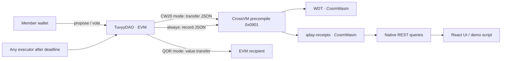

# Tuvyy

**A shared decision. One atomic outcome.** A member-governed treasury for QoreChain's Build Before Q-Day Cross-VM track. Members propose and vote in Solidity; successful execution pays a grant and writes an immutable receipt to the existing CosmWasm receipt book.

**Status: live on Diana testnet.** Proposal #1 paid 2 QOR and wrote Native receipt #3; addresses and verification evidence are below and in `config/deployments.json`. This is a hackathon prototype, not an audited or production-ready treasury.

## Why cross-VM?

The vote and authorization live on EVM, while shared receipt storage lives on QoreChain Native (CosmWasm). For a WDT payout, the treasury's funds also live on Native as CW20 balances. Execution uses the synchronous bridge so failure on either lane rolls back the entire transaction, including the proposal's executed flag.

**Atomic transaction, not one bridge invocation:** CW20 mode uses **two** bridge calls (transfer + record); native-QOR mode uses an EVM value transfer + **one** bridge call (record). There is no generic multi-target bridge payload. We do not represent a token allowance as a payment.



## Repository

* `contracts/TuvyyDAO.sol` — fixed owner, owner-managed members, fixed quorum/voting duration, proposal/vote/execute flow, synchronous bridge integration and payable treasury.
* `test/TuvyyDAO.t.sol` — Foundry tests; bridge code installed at `0x901` with `vm.etch`. No live chain or private key needed.
* `scripts/` — TypeScript hybrid-account setup, deployment and real on-chain demo automation.
* `web/` — Vite/React user interface using injected EVM wallets and read-only Native REST.
* `config/chain.ts` — shared Diana preset and ABI; `config/deployments.json` — deployment metadata consumed by scripts and UI.

## Network and addresses

| Item | Diana testnet |
|---|---|
| Cosmos chain ID | `qorechain-diana` |
| EVM chain ID | `9800` (`0x2648`) |
| EVM JSON-RPC | `https://evm-testnet.qore.host` |
| Cosmos RPC | `https://rpc-testnet.qore.host` |
| REST | `https://api-testnet.qore.host` |
| Explorer | https://explore.qore.network — select **Testnet** |
| Faucet | https://dashboard.qorechain.io/faucet — authenticated, 100 QOR / 24 hours |
| Tuvyy DAO EVM address | [`0xa2a86e88a90045de4fa5edf5dddca4b722cb9ef0`](https://explore.qore.network/address/0xa2a86e88a90045de4fa5edf5dddca4b722cb9ef0) |
| Tuvyy DAO qor1 address | [`qor1525xaz9fqpzauna9ah6amh9yku3vh8hs72ag5s`](https://explore.qore.network/address/qor1525xaz9fqpzauna9ah6amh9yku3vh8hs72ag5s) |
| Deployer / sole member / owner | `0x506E07d8Ad1445AeF16Aba109c47652290a64497` |
| Deployer qor1 address | [`qor12phq0k9dz3z6aut2hggfc3m9y2g2v3yheaxg4y`](https://explore.qore.network/address/qor12phq0k9dz3z6aut2hggfc3m9y2g2v3yheaxg4y) |
| Voting period / quorum | 60 seconds / 1 yes vote |
| Deployment EVM tx | `0x7b76aa193451538bf6ab43d4082a5815a81bdeb6189df78daeaa992de4969383` — [block 10482962](https://explore.qore.network/block/10482962) |
| Execution EVM tx | `0x869fa8e94edaa6d8111d2d87ead400c1f4dee36a5283375598034caa5426bb5e` — [block 10483018](https://explore.qore.network/block/10483018) |
| Native receipt | ID **3**, proposal **1**, sender is the DAO's qor1 address |
| Bridge | `0x0000000000000000000000000000000000000901` |
| WDT CW20 | `qor14hj2tavq8fpesdwxxcu44rty3hh90vhujrvcmstl4zr3txmfvw9s93uuqt` |
| qday-receipts | `qor1xjayq5ev55tkzpml9klxwyshr7gdrha0nurha9jhm0f0gdckksgs3gltw8` |

The deployment script uses the bridge and target defaults in this config, writes the real DAO address, its qor1 encoding and deployment transaction after confirmation. Rebuild the UI after updating config. It refuses to overwrite an existing DAO deployment silently.

The DAO's qor1 identity is Bech32(prefix `qor`) of its **same 20 EVM-address bytes**. It is the sender the Native contracts see, not the wallet that called `execute`. Fund the DAO's qor1 identity with **WDT** for CW20 mode; fund its EVM address with **QOR** for native mode. WDT has 6 decimals; QOR uses 18-decimal EVM wei, versus 6-decimal bank `uqor` for native fees.

### Verified live native demo

Select **Testnet** in the explorer linked above. PQC registration and a hybrid-signed EVM window succeeded before deployment. The demo used `PAYOUT_KIND=NATIVE QOR_AMOUNT=2 npm run demo` from `scripts/`: fund DAO with 2 QOR, propose a payout back to the deployer, vote yes, wait 60 seconds, then execute. Proposal #1 is now executed with yes=1/no=0; the DAO balance returned to zero. The shared receipts count increased **2 → 3**.

The recipient is also the executor, so its observed balance increase is the 2 QOR payout minus execution gas:

| Measurement | QOR |
|---|---:|
| Recipient immediately before execution (after funding/propose/vote) | 17.455797025 |
| Recipient after execution / remaining deployer balance | 19.3986635625 |
| Net recipient increase | 1.9428665375 |
| Execution gas cost (507853 gas × 112.5 gwei) | 0.0571334625 |

Starting funding was 20 QOR. Registration/window each cost 0.1 QOR; total net setup/deployment/demo fees were 0.6013364375 QOR, leaving well above the 5 QOR reserve. Native bank REST reports `19398663 uqor` (the EVM balance retains sub-uqor precision). The window was bounded to 600 blocks, 8 transactions and 10000000 uqor of cumulative fee/value authorization; that limit is not an upfront fee and will expire.

Exact Native receipt query (read-only):

```sh
QUERY=$(printf '%s' '{"receipt":{"id":3}}' | base64 | tr -d '\n')
curl -s "https://api-testnet.qore.host/cosmwasm/wasm/v1/contract/qor1xjayq5ev55tkzpml9klxwyshr7gdrha0nurha9jhm0f0gdckksgs3gltw8/smart/$QUERY"
```

```json
{"data":{"id":3,"sender":"qor1525xaz9fqpzauna9ah6amh9yku3vh8hs72ag5s","note":"Tuvyy #1: NATIVE 2000000000000000000; Demo grant","height":10483018}}
```

### Important constraints

* Existing Native targets above are bridge-allowlisted. A newly deployed DAO does **not** need EVM allowlisting. A newly instantiated Native contract is **not** automatically bridge-approved.
* Wasm upload is governance-controlled/circuit-disabled. This project needs no upload: it uses the existing WDT and receipts contracts.
* All WDT supply was held by the creator/minter at research time. The faucet supplies QOR/fest tokens, **not WDT**. Arrange a WDT transfer/mint before selecting CW20. Native mode is a useful real payout path without pretending WDT is available.
* EVM writes, including contract deployment, require the submitting account's registered ML-DSA-87 key and an open EVM authorization window. Connecting MetaMask alone does not open one.
* Check current activation, allowlist and circuit state before deployment:

```sh
curl -s https://api-testnet.qore.host/qorechain/crossvm/v1/params
curl -s https://api-testnet.qore.host/cosmos/circuit/v1/disable_list
curl -s https://api-testnet.qore.host/cosmos/evm/vm/v1/params
```

## DAO rules

Constructor: `(address[] initialMembers, uint256 votingPeriodSeconds, uint256 quorum, address bridge, string wdt, string receipts)`.

* `propose(recipientQor1, recipientEvm, amount, note, payoutKind)` — members only; IDs begin at **1**. `CW20 = 0`, `NATIVE = 1`. Amount is positive integer smallest units. The note may be empty, capped at 512 UTF-8 bytes. Only the recipient for the chosen kind is used.
* `vote(id, support)` — one vote per member/address, strictly before deadline. No automatic proposer vote. Membership is checked **at voting time**, not snapshotted; votes already cast remain if a member is removed. Fixed owner can `setMember(address, bool)`; ownership/quorum/duration cannot be changed. The owner must keep enough active members to meet quorum.
* `execute(id)` — anyone, at or after deadline, when `yes > no` and `yes >= quorum`. Marks executed before calls; guards reentrant execution across proposals. Native or bridge failure reverts payout, receipt and executed flag together, allowing retry after a transient funding failure.
* Receipt note is `Tuvyy #<id>: CW20 <raw amount>; <user note>` or `Tuvyy #<id>: NATIVE <wei>; <user note>`, truncated to at most **140 UTF-8 bytes** on a character boundary (conservative relative to the receipt book's 140-character limit). JSON quotes, backslashes and all control bytes are escaped. Native contract trims leading/trailing whitespace.
* On-chain qor1 validation enforces prefix, length and alphabet to prevent JSON injection; the UI also verifies Bech32 checksum. The bridge/target ultimately validates addresses. Receipt text is not independently verified proof of payment; correlate it with the successful DAO execution transaction and sender identity.
* `proposalCount`, `getProposal(id)`, `hasVoted(id, address)`, `members`, `quorum` and `votingPeriod` are readable. Member changes, proposals, votes, executions and received native funding emit events.

## Install and check locally

Requires Node.js **20.19+** (Node 22/24 recommended), npm, and [Foundry](https://getfoundry.sh) with Solidity 0.8.24. This is an npm workspace: install **once from the repository root**. There is no forge-std dependency; tests define the small cheatcode interface they use.

```sh
npm ci
forge build && forge test -vv

# Run in web/
cd web
npm run build
npm run dev
# Open http://localhost:5173
```

```sh
# Run in scripts/ after the root npm ci
npx tsc --noEmit
```

The web page shows an explicit undeployed/empty state until config contains a real DAO. It never substitutes fake proposals. The shared Native receipt book can still be queried. It displays the latest 20 shared receipts (not all belong to Tuvyy), supports older-proposal pagination and refreshes on-chain voting state every 12 seconds. Wallet transactions are simulated, signed and confirmed with viem; errors and pending hashes are shown. A wrong-chain wallet must switch to 9800. Setup/deployment screens are intentionally separate from ordinary voting UI.

## Account setup and deployment reference

The following commands **send transactions** except `init` / `status`. They were used for the live testnet run above; do not rerun them blindly against the existing deployment or regenerate its PQC recovery code. Defaults are a single deployer member, 60-second voting period, quorum 1, suitable for a testnet demonstration, not a production governance policy.

### 1. Keys and faucet

Keep the ECDSA private key outside the repository. The default is `~/tuvyy-secrets/deployer.key`. Optionally set `DEPLOYER_KEY_PATH` or `DEPLOYER_KEY` in your shell; never echo it or pass it as a CLI argument. Files under `~/tuvyy-secrets` must not be committed. `.env` is ignored and is **not automatically loaded**; on Node 22+ one can use `node --env-file=../.env --import tsx account.ts status` from `scripts/`.

```sh
chmod 700 ~/tuvyy-secrets
chmod 600 ~/tuvyy-secrets/deployer.key
cd scripts
npm run account -- init
npm run account -- status
```

`init` creates a separate private ML-DSA recovery-code file at `~/tuvyy-secrets/pqc-recovery-code` with mode 600 and refuses to overwrite it. `PQC_RECOVERY_PATH` or `QORE_PQC_RECOVERY_CODE` can override this. **Back up both secrets separately. Never regenerate the PQC code after key registration:** it derives the account's ML-DSA key, and a changed code will not match the registered key. The script refuses a detected mismatch. No secret is printed.

Fund the printed public qor1 address at the faucet. The unfunded account cannot register/open a window; faucet access requires an authenticated human session.

### 2. Register the hybrid key and open a window

```sh
npm run account -- register
npm run account -- open
```

Registration uses the chain's one-time classical registration path with proof of possession; opening is signed hybrid secp256k1 + ML-DSA-87 with `EthNativeSigner`. Defaults: 1200 blocks, 12 transactions, fee/value budget sized with `evmWindowCost` for 6M gas × 250 gwei per transaction plus 1 QOR. Override `WINDOW_BLOCKS`, `WINDOW_TXS`, `WINDOW_MAX_UQOR` deliberately; use minimal budgets for your actual workflow. This demonstration window is not target-restricted, because contract creation precedes knowing the deployment address. It has bounded time/transactions/value and should not be reused as a production policy. Native registration/window fees are configured at 100000 uqor and gas 800000, following the workshop; revisit if the chain fee policy changes.

### 3. Deploy

Run `forge build` from repo root first, then from `scripts/`:

```sh
# Optional: use comma-separated EVM members, seconds and an integer quorum
# export DAO_MEMBERS=0x...,0x...
# export VOTING_PERIOD=60
# export QUORUM=1
npm run deploy
```

The script reads `out/TuvyyDAO.sol/TuvyyDAO.json`, verifies chain 9800, deploys and waits for success, and writes `config/deployments.json`. No keys go into config. The deploying wallet is the member-management owner. Use an appropriate membership/quorum policy before managing anything valuable.

### 4. Real demo

```sh
# scripts/; requires deployer member + quorum 1
npm run demo

# Only after receiving WDT at the DAO's qor1 address:
PAYOUT_KIND=CW20 WDT_AMOUNT=1000000 npm run demo
```

Default native demo sends 0.001 QOR into the DAO, proposes a payment back to the deployer, casts its vote, waits against **chain block timestamp**, executes, prints transaction hash + DAO qor1, decodes the receipt ID returned in the execution event, and reads **that exact new receipt** via REST (not just the shared book's latest item). It checks receipt sender and retries briefly for REST propagation. CW20 demo checks actual DAO balance first. It does not mint WDT or count allowances as funds. `QOR_AMOUNT` uses display QOR; `WDT_AMOUNT` uses raw 6-decimal units. Ensure the authorization window lasts beyond the voting period.

## Tests and limitations

Foundry covers both exact JSON payout paths, receipt failure undoing native/CW20 payout, bridge payout failure, retry, double execution/voting, non-member actions, early execution, tie/no votes/quorum failure, late voting, insufficient/rejecting native recipient, reentrant recipient, empty notes, control/quote/backslash escaping, ASCII/Unicode truncation, membership changes, invalid inputs and an inactive bridge.

The mock demonstrates EVM transaction rollback. The live run verified PQC registration, window opening, deployment, voting, a native payout and a receipt whose sender is the DAO; it did not exercise a failing bridge transaction or a funded CW20 payout on Diana. Live cross-VM rollback under failure remains unverified. The frontend is build/typechecked but visually unverified. The bridge/receipt book remain dependencies governed by QoreChain. Standard timestamp, external-call and packed-encoding linter warnings should be reviewed in context: voting uses time by design, execution is guarded, and packed encoding constructs JSON rather than a hashed authorization message.

## Kits and credits

Built from the official [Build Before Q-Day Workshop 3: Cross-VM checkout](https://github.com/qorechain/build-before-qday/tree/main/workshop-3/02-cross-vm), upstream commit `2af5c77999d5027ef41bb160bd4759da4a38a43a`. In particular:

* `scripts/account.ts` adapts `evm/scripts/window.ts` (PQC derivation, proof of possession, signing, window costs).
* `contracts/TuvyyDAO.sol` adapts the `CrossVmCheckout.sol` bridge invocation/response-handling pattern.
* qday-receipts execute/query formats follow the workshop's `native/src/lib.rs`; this repo does not redeploy that shared contract.

The workshop is **Apache-2.0**, not MIT. Its attribution and terms are retained in [NOTICE](NOTICE) and [THIRD_PARTY_LICENSES/Apache-2.0.txt](THIRD_PARTY_LICENSES/Apache-2.0.txt). Original Tuvyy work is MIT; [AI_USAGE.md](AI_USAGE.md) records AI assistance.

Actual dependency usage:

* `@qorechain/sdk` — official network presets in scripts/UI; unified EVM/native accounts, ML-DSA signing and native message construction in account setup.
* `@qorechain/evm` — EVM authorization-window status and budget calculation.
* `viem` — deployment, typed EVM reads, wallet writes/simulation, receipt/events and units.
* Foundry — Solidity compilation and local rollback/security regression tests; React + Vite — user UI.

No kit was added solely for a judging badge. The project uses the synchronous EVM precompile, **not** an asynchronous queued call.

References: [Cross-VM reference](https://docs.qorechain.io/developer-guide/cross-vm-reference/), [workshop](https://github.com/qorechain/build-before-qday/tree/main/workshop-3/02-cross-vm), [hackathon kits](https://build.qorechain.io/kits), [rules](https://build.qorechain.io/rules).
